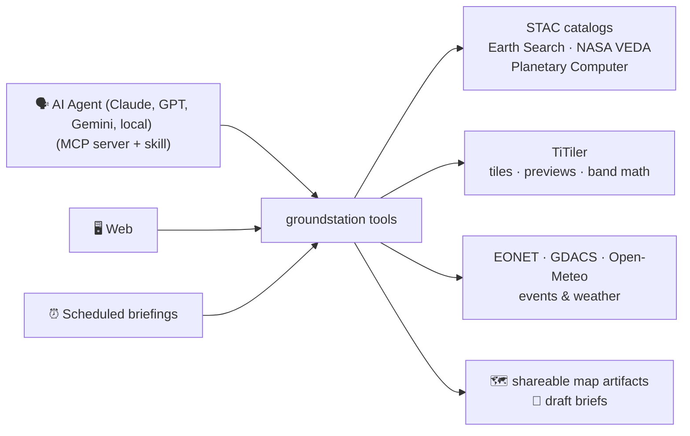
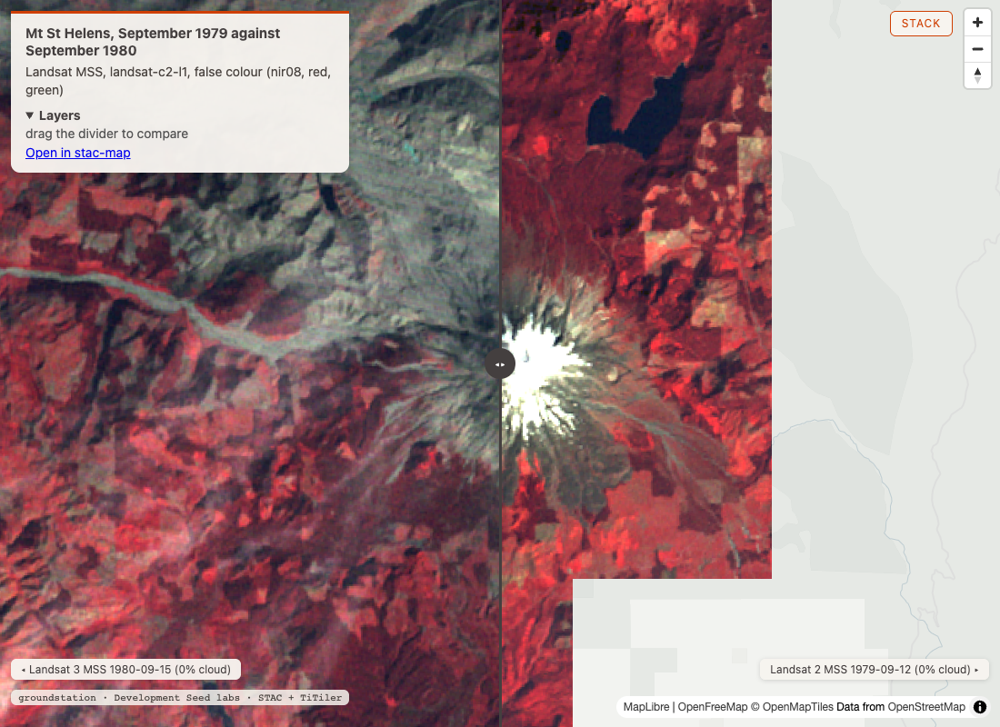

# groundstation

Earth data, agent ready. A [Development Seed](https://developmentseed.org) MCP prototype giving easy access to a variety of cloud-native geospatial stacks, with visual examples and repeatable workflows called "field tests".

Cloud-native geospatial exists because the satellite archives grew to petabytes, and downloading whole scenes to look at one field stopped making sense. With STAC to find the data, cloud-optimized formats (COG, Zarr) to read only the pixels you need, and TiTiler to render them on demand, most questions about a place can be answered in seconds against the open archive. That is the exciting part: an agent can now reach the whole Earth record as easily as it reaches a web page.

Ask a question about any place on Earth. groundstation finds satellite imagery, active fires, disaster alerts and weather, does the pixel math, and returns data, stories and interactive maps. 3 ways in:



Everything runs against public, keyless endpoints, so it works anywhere with nothing to sign up for. It supports any MCP client, like Claude Code, Codex, Gemini CLI or Cursor.

## What it lets an agent do

- Answer a question about a place. Find the right scene, do the pixel math, and come back with numbers, their caveats, and a map to share
- Think alongside you. In a brainstorm or design session, pull real imagery and numbers for a place while the idea is still forming, and sketch a map the room can react to
- Explore before committing. See what data exists for a place, at what resolution and how fresh, before anyone scopes a project around it
- Watch places and report back. Brief you each morning on what changed, and stay quiet about what didn't


## Examples

The 5 examples are the cards from field test 20 ([`docs/field-test-2026-10-27-no20.html`](docs/field-test-2026-10-27-no20.html)), real runs on real data: quick examples that open the door to digging in further, and a way to learn which stack to consider for your own use case (`docs/field-test-*.html`, highest number is newest).

"Mt St Helens eruption 1980" The tools found 2 Landsat MSS scenes from the same orbit, 1979-09-12 and 1980-09-15, both 0.0% cloud. Over the box around the mountain the median vegetation index fell from 0.2691 to -0.0043. A swipe map puts the 2 scenes side by side. [Map](docs/img/ft20-st-helens-map.html)

"Hurricane Patricia 2015" Landsat 8 has the coast on 2015-10-13 and 2015-11-30, and the median vegetation index over a box on the land went from 0.8712 to 0.8226. The after scene is cloudier, so that number is a hint, not a damage measure. [Map](docs/img/ft20-patricia-map.html)

"Switzerland's glaciers are disappearing at an alarming rate, losing more than 5% of their ice volume in 2026 alone" Sentinel-2 has the Great Aletsch glacier on 2017-08-23 and 2026-08-30, and the late-summer snow and ice index rose 7.9%. That is snow on the day, not ice volume, so the 5% volume loss stays with the glacier monitoring network's measurement. The tools showed the glacier on both dates with a swipe map. [Map](docs/img/ft20-aletsch-map.html)

"Eagle Creek fire 2017, Columbia River Gorge" Sentinel-2 has the gorge on 2017-08-26, 7 days before the fire started on 2017-09-02 (a date from outside the tool output), and on 2017-10-05, both under 0.4% cloud and from the same tile. Over the box the mean burn index (NBR) fell from 0.6415 to 0.4305, -32.9%, and the swipe map shows the burn south of the river. [Map](docs/img/ft20-eagle-creek-map.html)

"What's going on around Portland, Oregon right now: fires, floods, weather, and when the next clear satellite pass is" At 04:59 UTC on 2026-10-27, GDACS listed 0 active events but EONET returned a server error, so that is not an all-clear. It rained 15.1 mm on 2026-10-25 with more forecast, the next daylight pass is Sentinel-3B at 18:16 UTC on 2026-10-27, with Landsat 8 at 18:56 (passes are predicted, not cloud), and the clearest Sentinel-2 scene from 2026-10-12 to 2026-10-26 is 2026-10-15 at 0.3% cloud. [Map](docs/img/ft20-portland-map.html)



## Quickstart

You need [uv](https://docs.astral.sh/uv/). Clone the repo and build the environment:

```bash
git clone https://github.com/dannybauman/groundstation && cd groundstation && uv sync
```

Then point any MCP client at it (Claude, Codex, Gemini CLI, Cursor, a local model's client). Most read a config like this:

```json
{
  "mcpServers": {
    "groundstation": {
      "command": "uv",
      "args": ["--directory", "/path/to/groundstation", "run", "groundstation"]
    }
  }
}
```

The skills in `skills/` are plain markdown, so any agent can read them as instructions. Then ask for a map of your hometown.

In Claude Code, the plugin brings the server and the skills in one step, with no clone:

```
/plugin marketplace add dannybauman/groundstation
/plugin install groundstation@groundstation
```

The first launch builds the server's environment, so the tools appear a few seconds after the agent starts. With the plugin you can also just ask: "demo groundstation", "is groundstation running", "open the field tests" and "brief me on Lisbon" all run through the `groundstation` skill.

If the tools don't show up, run the preflight. It walks the setup chain in the order it breaks (uv, server env, Claude Code CLI, plugin wiring, endpoints) and prints the fix for the first broken link:

```bash
bash scripts/doctor.sh
```

Without an agent:

```bash
# the web console, at http://127.0.0.1:8765
uv run --group web groundstation-web

# a brief for one place, or the morning sweep over a watch list
uv run briefing/brief.py --place "Chelan County, Washington" --days 10
uv run briefing/brief.py --fleet briefing/fleet.json
```

### Updating

With a clone, `git pull` and restart your agent. Claude Code plugin installs are cached per version, so they stay as they were until you update them:

```bash
claude plugin marketplace update groundstation
claude plugin update groundstation@groundstation
```

Then restart Claude Code. `scripts/doctor.sh` says which copy you are running and whether it is behind.

## Things to ask it

Paste any of these into your agent as is.

```text
Find the clearest Sentinel-2 scene of Lake Chelan from the past 2 weeks, tell me what's burning nearby, and give me a map I can share.
```

```text
How much surface water is on the Barotse Floodplain right now vs early March? Use NDWI, give me numbers and a swipe map.
```

```text
What does NASA VEDA have on the Caldor fire? Put the burn severity layer over a current scene.
```

```text
Any active flood alerts along the Rio Grande between El Paso and Laredo? Alerts, week-ahead rain, latest usable imagery, one map.
```

```text
Give me a 3D fly-through of Torres del Paine.
```

```text
Make me a postcard of that I could post.
```

The first `search_datasets` call takes a few seconds while collection lists cache. After that it is near instant for an hour.

## What an agent gets

| Tool | What it does | Backed by |
|---|---|---|
| `geocode` | place name to coordinates and a bbox | the fuzzy index in Gazet, Development Seed's geocoder (Overture divisions, urban centres, Natural Earth), with Nominatim as the fallback |
| `list_catalogs` / `search_datasets` / `describe_collection` | find the right data across catalogs, filtered by place and resolution (`bbox`/`place`, `max_gsd`) | Earth Search, NASA VEDA, Planetary Computer, plus a curated `zarr` list (HRRR forecast, ERA5, GFS and MUR SST as metadata) |
| `search_imagery` | recent scenes with cloud filtering, plus the scene to start from and why | STAC APIs, or a stac-geoparquet archive via rustac (offline) |
| `write_archive` | cache a live search as a stac-geoparquet file that `search_imagery` takes as its catalog | rustac |
| `preview_item` / `tile_url_template` | browser-openable previews and XYZ tiles | titiler.xyz, VEDA raster API, PC data API |
| `compute_statistics` | band math over a scene: NDVI is `(nir-red)/(nir+red)`. With `catalog="zarr"`, a clipped statistic from a Zarr forecast (HRRR, CONUS only), e.g. the temperature over Laredo tomorrow | TiTiler statistics; xarray + zarr + obstore |
| `compare_dates` | "what changed?" in one call: same-tile scenes, index delta, swipe map | all of the above |
| `render_map` | self-contained interactive HTML maps. 2 rasters become a swipe compare | MapLibre + live tiles |
| `render_map_3d` | terrain fly-throughs: imagery draped over real relief | MapLibre terrain + keyless AWS Terrarium tiles |
| `render_timelapse` | 2 to 12 frames (default cap 8) of one place over time, with prev / play / next; a frame loads tiles only when shown | MapLibre, hidden layers fetch nothing |
| `render_postcard` | share cards with the pixels embedded and attribution baked in, so nothing expires | TiTiler previews |
| `active_events` / `weather_summary` | open fires, floods and storms, plus the past and coming week of weather | NASA EONET, GDACS, Open-Meteo |
| `smoke_forecast` | near-surface smoke now and hours ahead (CONUS) | NOAA HRRR smoke through raster.eoapi.dev, model guidance not observation |
| `next_pass` | when a satellite could next image a place | Celestrak orbits, constellations read from [eo-predictor](https://github.com/developmentseed/eo-predictor)'s catalog |
| `conditions_brief` | current conditions around a place in one call: dryness, wind, events, the latest look, the next pass | the tools above |

Numbers come with caveats. If a change figure sits on a cloudy scene, or a statistic covers a whole tile, or the tiler could not read a scene, the tool says so next to the number. Details in `docs/adr-caveats.md`.

Every map and postcard has a Stack panel, and a brief has it on its map, not on the page. It lists what made it, in order. `docs/stack.md` is the list, and a new tool is one line.

The skills in `skills/` tell the agent which catalog to use, how assets are named, how to compute the common indexes, and to end every spatial answer with a map.

## Briefings

A briefing runs on a schedule and says what changed at a place: new scenes, events, weather, NDVI against last month, a CALM, WATCH or ACT level, and what to look at next. It is an HTML page you can share. Each place remembers its last run, so "what changed" means since then. The written summary comes from `claude -p` by default, or a local model if you set one up. Without either, you get a data-only brief.

Scheduling, Slack delivery and local-model summaries are in `docs/briefing.md`.

## titiler.xyz is shared

Tiles, previews and pixel math use titiler.xyz by default. Development Seed runs it as a free demo, and it rate-limits (HTTP 429) when busy. For scheduled briefings, batch runs or a live demo, run your own:

```bash
docker compose up -d titiler                          # TiTiler is one container, see compose.yml
export GROUNDSTATION_TITILER=http://localhost:8000    # everything routes there
```

Any TiTiler with the `/stac` router works. One catch: NAIP and Landsat on Earth Search are requester-pays. titiler.xyz has credentials for those. A local TiTiler returns 500s on them until you add your own (see `compose.yml`) or use Planetary Computer's copies.

## Checks

- `uv run evals/unit_checks.py`: offline, runs in CI on pushes to main and on pull requests
- `uv run evals/run_evals.py`: live, against the real endpoints, on demand and weekly in CI
- `uv run evals/brief_checks.py`: every event a brief mentions has to be in its input data

## More

- `docs/field-test-*.html`: the field tests, one page per round, highest № is newest. Real prompts, graded answers, and what got fixed. `docs/field-test.html` and `docs/examples.md` are the first edition, served at `/docs/field-test.html` when the console is running
- `docs/architecture.md`: how it fits together and what is left out on purpose
- `docs/plan-2026-10-devseed-stack.md`: the plan, most of it shipped (the smoke forecast, Zarr stores, cross-catalog search, stac-geoparquet archives); the open items are at the end
- For deeper exploration, [stac-map](https://github.com/developmentseed/stac-map) renders COGs in the browser with [deck.gl-raster](https://github.com/developmentseed/deck.gl-raster). Tiles and pixel math use [TiTiler](https://github.com/developmentseed/titiler)

MIT licensed, see `LICENSE`.
