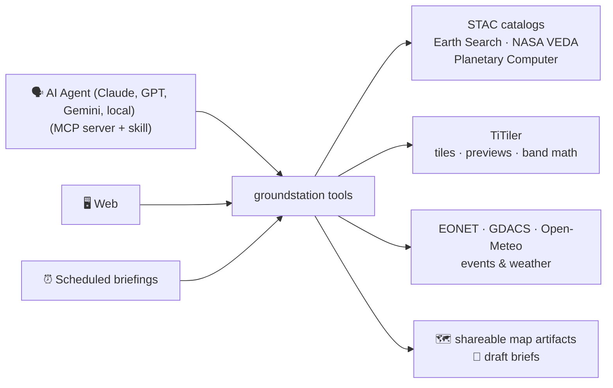
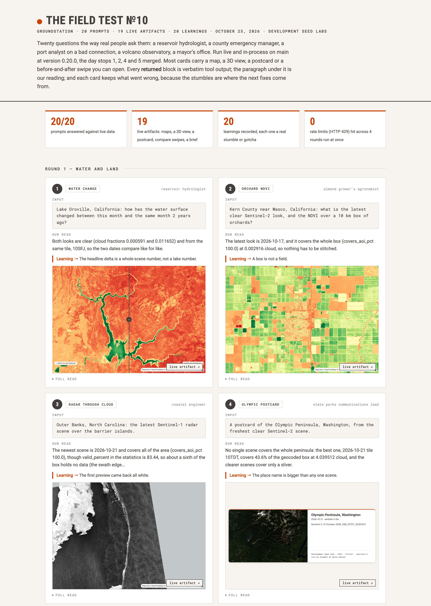
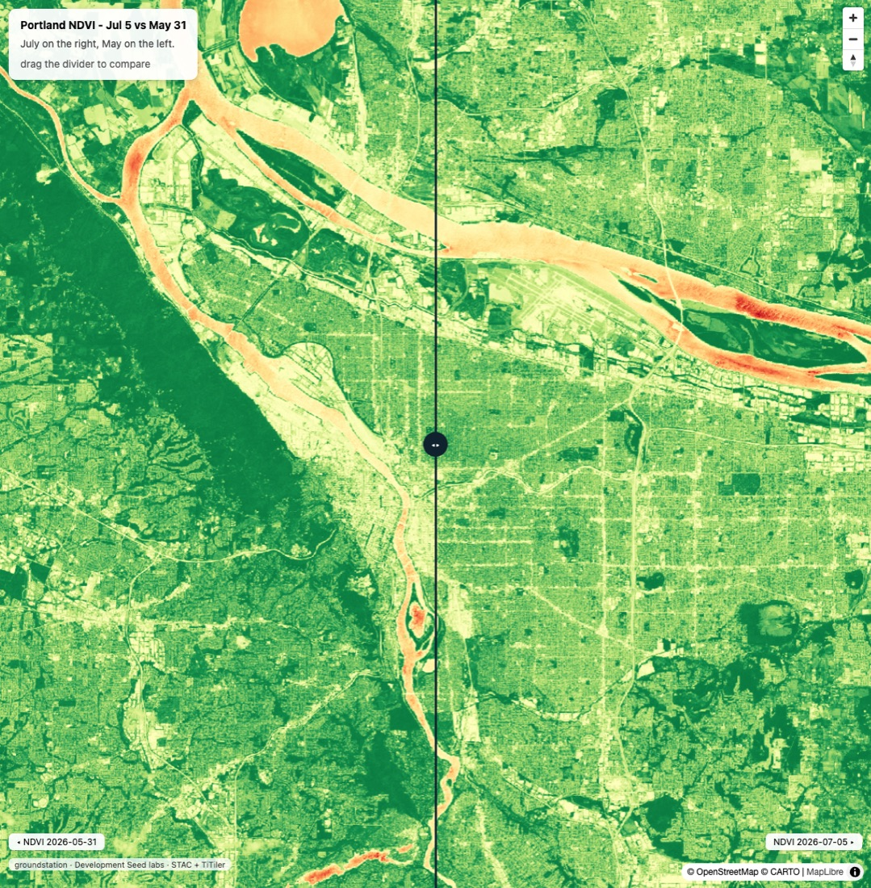

# groundstation

Earth data, agent ready. A [Development Seed](https://developmentseed.org) MCP prototype giving easy access to a variety of cloud-native geospatial stacks, with visual examples and repeatable scenario workflows called "field tests".

Ask a question about any place on Earth. groundstation finds satellite imagery, active fires, disaster alerts and weather, does the pixel math, and returns data, stories and interactive maps. 3 ways in:



Everything runs against public, keyless endpoints, so it works anywhere with nothing to sign up for. It supports any MCP client, like Claude Code, Codex, Gemini CLI or Cursor.

## What it lets an agent do

- Answer a question about a place. Find the right scene, do the pixel math, and come back with numbers, their caveats, and a map to share
- Think alongside you. In a brainstorm or design session, pull real imagery and numbers for a place while the idea is still forming, and sketch a map the room can react to
- Explore before committing. See what data exists for a place, at what resolution and how fresh, before anyone scopes a project around it
- Watch places and report back. Brief you each morning on what changed, and stay quiet about what didn't



## Examples

All 3 are real runs on real data.

"What's burning near Chelan County?" One scan found the 2 active wildfires (Navarre Coulee, Chelan Hills), correlated them with 14 straight days of zero rain and a 33°C heat peak in the forecast, and pointed at the 3 sub-1%-cloud scenes from ignition day.

"How did vegetation change around Wenatchee?" One `compare_dates` call matched 2 scenes from the same Sentinel-2 tile (10TFT, both about 1% cloud) and answered: NDVI 0.46 → 0.63 between May 28 and July 5, a +36% spring green-up, with a swipe map to see it.

"Watch these 4 places every morning." The fleet sweep triaged Chelan ACT (fires + heat), Efate and Laredo WATCH, Barotse CALM ("NDVI 0.397 → 0.395, normal dry-season drift, not a distress signal"). On its second run the Chelan brief opened with *"unchanged since this morning's earlier run"*. It remembers yesterday and only makes noise about what's new.



## Quickstart

You need [uv](https://docs.astral.sh/uv/). Clone the repo and build the environment:

```bash
git clone https://github.com/dannybauman/groundstation && cd groundstation && uv sync
```

Then point any MCP client at it (Claude, Codex, Gemini CLI, Cursor, a local model's client). Most read a config like this:

```json
{
  "mcpServers": {
    "groundstation": {
      "command": "uv",
      "args": ["--directory", "/path/to/groundstation", "run", "groundstation"]
    }
  }
}
```

The skills in `skills/` are plain markdown, so any agent can read them as instructions. Then ask for a map of your hometown.

In Claude Code, the plugin brings the server and the skills in one step, with no clone:

```
/plugin marketplace add dannybauman/groundstation
/plugin install groundstation@groundstation
```

The first launch builds the server's environment, so the tools appear a few seconds after the agent starts. With the plugin you can also just ask: "demo groundstation", "is groundstation running", "open the field tests" and "brief me on Lisbon" all run through the `groundstation` skill.

If the tools don't show up, run the preflight. It walks the setup chain in the order it breaks (uv, server env, CLI, plugin wiring, endpoints) and prints the fix for the first broken link:

```bash
bash scripts/doctor.sh
```

Without an agent:

```bash
# the web console, at http://127.0.0.1:8765
uv run --group web groundstation-web

# a brief for one place, or the morning sweep over a watch list
uv run briefing/brief.py --place "Chelan County, Washington" --days 10
uv run briefing/brief.py --fleet briefing/fleet.json
```

### Updating

With a clone, `git pull` and restart your agent. Claude Code plugin installs are cached per version, so they stay as they were until you update them:

```bash
claude plugin marketplace update groundstation
claude plugin update groundstation@groundstation
```

Then restart Claude Code. `scripts/doctor.sh` says which copy you are running and whether it is behind.

## Things to ask it

- "Find the clearest Sentinel-2 scene of Lake Chelan from the past 2 weeks, tell me what's burning nearby, and give me a map I can share."
- "How much surface water is on the Barotse Floodplain right now vs early March? Use NDWI, give me numbers and a swipe map."
- "What does NASA VEDA have on the Caldor fire? Put the burn severity layer over a current scene."
- "Any active flood alerts along the Rio Grande between El Paso and Laredo? Alerts, week-ahead rain, latest usable imagery, one map."
- "Give me a 3D fly-through of Torres del Paine."
- "Make me a postcard of that I could post."

The first `search_datasets` call takes 20 to 30 seconds while collection lists cache. After that it is instant.

## What an agent gets

| Tool | What it does | Backed by |
|---|---|---|
| `geocode` | place name to coordinates and a bbox | the fuzzy index in Gazet, Development Seed's geocoder (Overture divisions, urban centres, Natural Earth), with Nominatim as the fallback |
| `list_catalogs` / `search_datasets` / `describe_collection` | find the right data across catalogs, filtered by place and resolution (`bbox`/`place`, `max_gsd`) | Earth Search, NASA VEDA, Planetary Computer, plus a curated `zarr` list (HRRR forecast, ERA5, GFS and MUR SST as metadata) |
| `search_imagery` | recent scenes with cloud filtering, plus the scene to start from and why | STAC APIs, or a stac-geoparquet archive via rustac (offline) |
| `write_archive` | cache a live search as a stac-geoparquet file that `search_imagery` takes as its catalog | rustac |
| `preview_item` / `tile_url_template` | browser-openable previews and XYZ tiles | titiler.xyz, VEDA raster API, PC data API |
| `compute_statistics` | band math over a scene: NDVI is `(nir-red)/(nir+red)`. With `catalog="zarr"`, a clipped statistic from a Zarr forecast (HRRR, CONUS only), e.g. the temperature over Laredo tomorrow | TiTiler statistics; xarray + zarr + obstore |
| `compare_dates` | "what changed?" in one call: same-tile scenes, index delta, swipe map | all of the above |
| `render_map` | self-contained interactive HTML maps. 2 rasters become a swipe compare | MapLibre + live tiles |
| `render_map_3d` | terrain fly-throughs: imagery draped over real relief | MapLibre terrain + keyless AWS Terrarium tiles |
| `render_timelapse` | 2 to 12 frames (default cap 8) of one place over time, with prev / play / next; a frame loads tiles only when shown | MapLibre, hidden layers fetch nothing |
| `render_postcard` | share cards with the pixels embedded and attribution baked in, so nothing expires | TiTiler previews |
| `active_events` / `weather_summary` | open fires, floods and storms, plus the past and coming week of weather | NASA EONET, GDACS, Open-Meteo |
| `smoke_forecast` | near-surface smoke now and hours ahead (CONUS) | NOAA HRRR smoke through raster.eoapi.dev, model guidance not observation |
| `next_pass` | when a satellite could next image a place | Celestrak orbits, constellations read from [eo-predictor](https://github.com/developmentseed/eo-predictor)'s catalog |
| `conditions_brief` | current conditions around a place in one call: dryness, wind, events, the latest look, the next pass | the tools above |

When a tool returns a derived number, it tries to say what could make that number misleading: a cloudy scene behind a change figure, statistics that cover a whole tile instead of the place, a scene the tiler could not read. Those caveats come back on the same object as the number. How that works is in `docs/adr-caveats.md`.

Every map, postcard and brief has a Stack panel listing the components that made it, in order, only the ones that actually ran. `docs/stack.md` is the list it draws from, and adding a tool is one entry.

The skills in `skills/` hold the know-how an agent needs: which catalog to use for what, how the assets are named, how to compute the common indexes, and to always end a spatial answer with a map.

## Briefings

A briefing runs on a schedule and tells you what changed at a place: fresh scenes, events, weather, an NDVI change against last month, a CALM, WATCH or ACT level, and what to look at next, as an HTML page you can share. It remembers the last run for each place, so "what changed" means since last time.

Scheduling with cron or launchd, Slack delivery, and writing the summary with a local model are in `docs/briefing.md`.

## titiler.xyz is shared

Tiling, previews and pixel math go through titiler.xyz by default. It is a free endpoint Development Seed runs as a demo, and it rate-limits (HTTP 429) when it gets busy. For scheduled briefings, batch runs, or a demo in front of a room, run your own:

```bash
docker compose up -d titiler                          # TiTiler is one container, see compose.yml
export GROUNDSTATION_TITILER=http://localhost:8000    # everything routes there
```

Any TiTiler with the `/stac` router works. One catch: NAIP and Landsat on Earth Search sit in requester-pays buckets. titiler.xyz has AWS credentials for those; a local TiTiler returns 500s on them until you add your own (see `compose.yml`) or use Planetary Computer's copies.

## Checks

3 kinds:

- `uv run evals/unit_checks.py`: offline and deterministic, runs in CI on every push
- `uv run evals/run_evals.py`: live checks against the real endpoints, on demand and weekly in CI
- `uv run evals/brief_checks.py`: checks that every event a brief claims exists in its input data

## More

- `docs/field-test-*.html`: the field tests, one page per round, highest № is the newest. Each one runs real prompts through an agent, grades the answers, and lists what got fixed. `docs/field-test.html` and `docs/examples.md` are the first edition, served at `/docs/field-test.html` when the console is running
- `docs/architecture.md`: how it fits together, the design decisions, and what is on purpose not built
- `docs/plan-2026-10-devseed-stack.md`: what comes next: Zarr through titiler.xyz, HRRR smoke in the briefs, cross-catalog discovery, stac-geoparquet archives, and a hosted toolset on mcp-toolsets-runtime, each tied to the Development Seed work it builds on
- For deeper exploration there is [stac-map](https://github.com/developmentseed/stac-map) (Pete Gadomski), which renders COGs in the browser with [deck.gl-raster](https://github.com/developmentseed/deck.gl-raster) (Kyle Barron). Tiling and pixel math use [TiTiler](https://github.com/developmentseed/titiler)

MIT licensed, see `LICENSE`.
